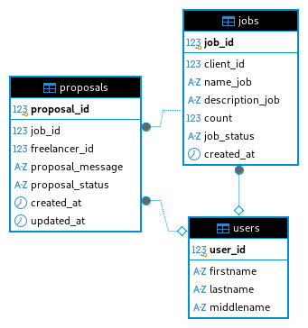

# Задание на Backend : Создание таблиц и полей

## Цель

Создать новую таблицу в базе данных для системы откликов в сервисе "WorkHub". Обеспечить их связность с существующими таблицами.

## Описание таблицы и полей

### Таблица `proposals`

| Название атрибута | Тип | Ограничения | Описание |
| --- | --- | --- | --- |
| proposal_id | SERIAL | PRIMARY KEY NOT NULL | Идентификатор отклика |
| job_id | INT | NOT NULL REFERENCES jobs(job_id) | Идентификатор заказа |
| freelancer_id | INT | REFERENCES users(user_id) | Идентификатор Исполнителя, оставившего отклик |
| proposal_message | VARCHAR(500) | - | Сопроводительный текст к отклику |
| proposal_status | ENUM (proposal_status) | NOT NULL DEFAULT 'pending' | Статус отклика (описание типа ниже) |
| created_at | TIMESTAMPZ | NOT NULL DEFAULT CURRENT_TIMESTAMP | Дата и время создания отклика |
| updated_at | TIMESTAMPZ | NOT NULL DEFAULT CURRENT_TIMESTAMP | Дата и время обновления отклика |

### Тип данных `proposal_status` для таблицы `proposals`

| Название статуса | Описание |
| --- | --- |
| pending | Статус, при котором Исполнитель заказа еще не выбран |
| rejected | Статус, при котором Заказчик отклонил этого Исполнителя или заказ был закрыт |
| accepted | Статус, при котором Заказчик выбрал этого Исполнителя для выполнения заказа |
| cancelled | Статус, при котором Исполнитель отменил свой отклик |

## SQL-скрипт создания таблицы

```
-- Создание типа данных proposal_status
CREATE TYPE proposal_status AS ENUM (
    'pending',
    'rejected',
    'accepted',
    'cancelled'
);

-- Создание таблицы proposals
CREATE TABLE proposals (
    proposal_id SERIAL PRIMARY KEY NOT NULL,
    job_id INT NOT NULL REFERENCES jobs(job_id),
    freelancer_id INT REFERENCES users(user_id),
    proposal_message VARCHAR(500),
    proposal_status proposal_status NOT NULL DEFAULT 'pending',
    created_at TIMESTAMPTZ NOT NULL DEFAULT CURRENT_TIMESTAMP,
    updated_at TIMESTAMPTZ NOT NULL DEFAULT CURRENT_TIMESTAMP
);
```

## ER-Diagram



