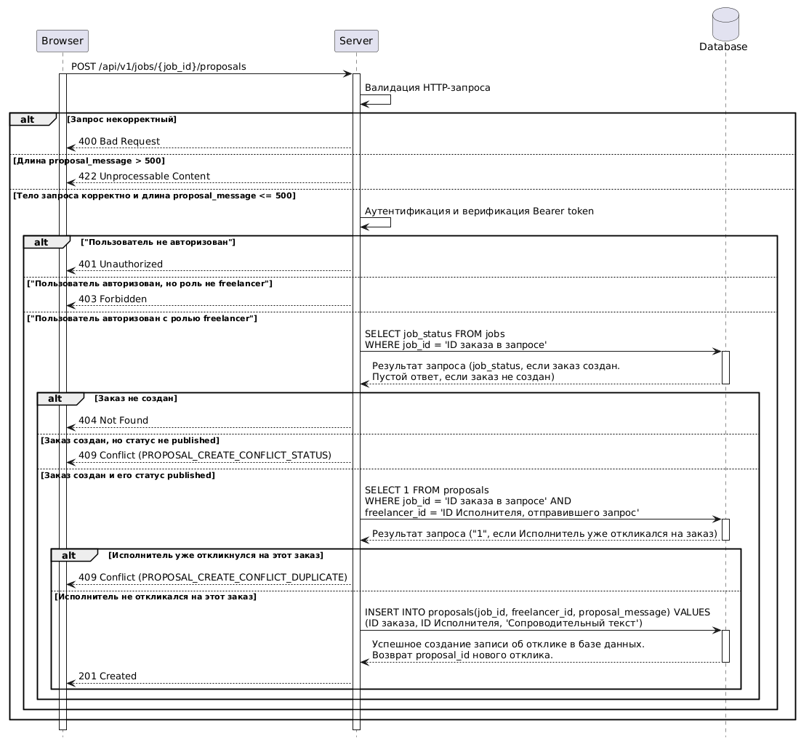
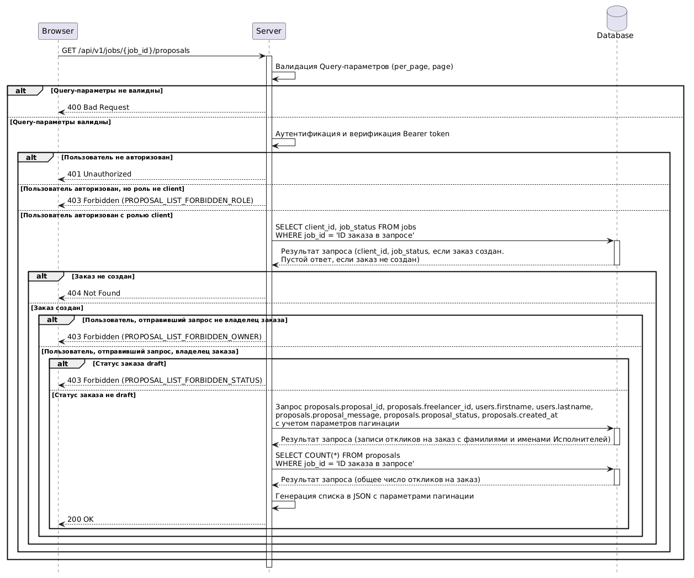
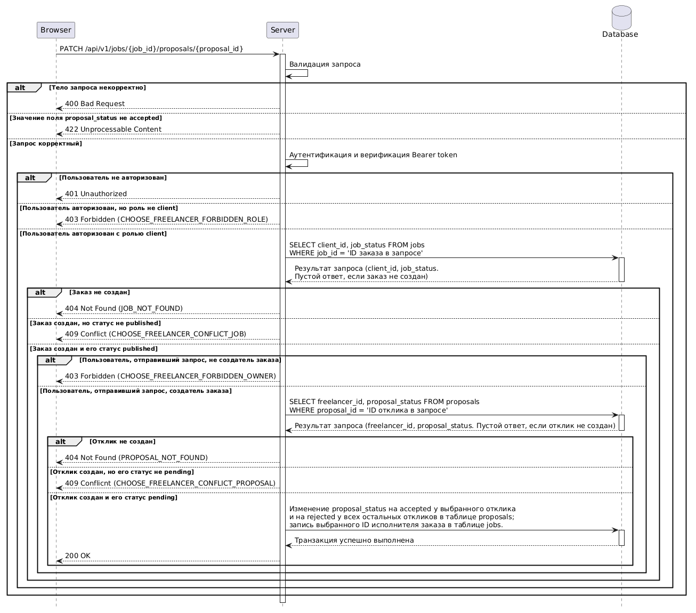
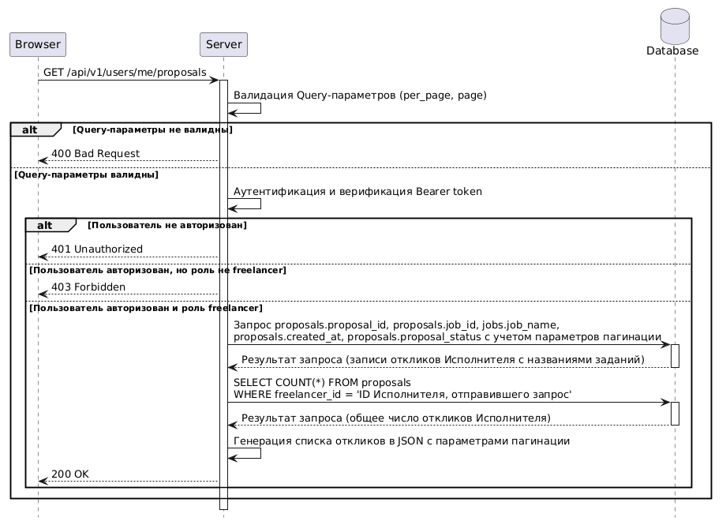

# Задание на Backend : Реализация бизнес-логики на сервере

## Цель

Реализовать необходимые процессы обработки данных и логику бэкенда.

## Функциональные требования

### BE-1 : Создание отклика

* Получение запроса на создание отклика 

  1. Сервер начинает серию проверок и создание отклика при получении `POST /api/v1/jobs/{job_id}/proposals` запроса.

* Проверка тела запроса

  1. Сервер должен проверить наличие поля `proposal_message` в теле запроса.
  2. Сервер должен возвращать ошибку `400 Bad Request`, если поле `proposal_message` отсутствует в теле запроса.

* Проверка длины сопроводительного текста 

  1. Сервер должен считать длину переданного сопроводительного текста.
  2. Сервер должен возвращать ошибку `422 Unprocessable Content`, если длина переданного сопроводительного текста больше 500 символов.

* Аутентификация и верификация токена доступа

  1. Сервер должен давать возможность оставлять отклик на заказ только авторизованному пользователю с ролью `freelancer`.
  2. Сервер должен возвращать ошибку `401 Unauthorized`, если пользователь, отправивший запрос, не авторизован. 
  3. Сервер должен возвращать ошибку `403 Forbidden`, если пользователь, отправивший запрос, авторизован **не** под ролью `freelancer`.

* Проверка заказа и его статуса

  1. Сервер должен разрешать отклик на заказ, если этот заказ существует в базе данных и его статус `published`.
  2. Сервер должен возвращать ошибку `404 Not Found`, если указанный в запросе заказ не существует в базе данных.
  3. Сервер должен возвращать ошибку `409 Conflict (PROPOSAL_CREATE_CONFLICT_STATUS)`, если статус заказа, указанного в запросе, **не** `published`.

* Проверка откликов Исполнителя

  1. Сервер должен сопоставлять ID заказов на которые откликнулся Исполнитель, с ID заказа, переданного в запросе.
  2. Сервер должен возвращать ошибку `409 Conflict (PROPOSAL_CREATE_CONFLICT_DUPLICATE)`, если Исполнитель уже откликнулся на этот заказ.

* Создание отклика 

  1. Сервер должен создавать новую запись об отклике в таблице `proposals` с указанием `job_id`, `freelancer_id`, `proposal_message` (если сопроводительный текст пустой, то не указывать).
  2. Сервер должен возвращать ответ `201 Created` при успешном создании отклика.

#### SQL-запросы 

[SQL-запросы для BE-1](/backend/sql-command.md#be-1)

#### Диаграмма последовательности

### BE-2 : Генерация списка откликов на заказ

* Получение запроса не генерацию списка откликов

  1. Сервер начинает серию проверок и генерацию списка откликов при получении `GET /api/v1/jobs/{job_id}/proposals` запроса.

* Валидация Query параметров

  1. Сервер должен возвращать ошибку `400 Bad Request`, если пользователь отправил запрос с некорректными Query-параметрами ([Формат Query-параметров](/backend/api-methods/api_method_2.md#query-параметры))

* Аутентификация и верификация токена доступа

  1. Сервер должен выдавать сгенерированный список откликов на заказ только авторизованному пользователю с ролью `client`.
  2. Сервер должен возвращать ошибку `401 Unauthorized`, если пользователь, отправивший запрос, не авторизован. 
  3. Сервер должен возвращать ошибку `403 Forbidden (PROPOSAL_LIST_FORBIDDEN_ROLE)`, если пользователь, отправивший запрос, авторизован **не** под ролью `client`.

* Проверка заказа

  1. Сервер должен генерировать список откликов только на существующий заказ.
  2. Сервер должен возвращать ошибку `404 Not Found`, если указанный в запросе заказ не существует в базе данных.

* Проверка на владельца заказа

  1. Сервер должен разрешать генерировать список откликов на заказ только пользователю, создавшему заказ.
  2. Сервер должен возвращать ошибку `403 Forbidden (PROPOSAL_LIST_FORBIDDEN_OWNER`, если пользователь, отправивший запрос, не является создателем заказа. 

* Проверка статуса заказа

  1. Сервер должен генерировать список откликов при любом статусе заказа кроме `draft`.
  2. Сервер должен возвращать ошибку `403 Forbidden (PROPOSAL_LIST_FORBIDDEN_STATUS)`, если статус заказа `draft`.

* Генерация списка откликов
  
  1. Сервер должен извлекать `proposal_id`, `freelancer_id`, `proposal_message`, `created_at` из таблицы `proposals` по переданному в запросе `job_id` с учетом параметров пагинации переданных в запросе.
  2. Сервер должен извлекать `firstname` и `lastname` для каждого `freelancer_id` из прошлого запроса.
  | Column1. Сервер должен извлекать из базы данных число откликов на заказ, переданный в запросе.
  3. Сервер должен генерировать список откликов на заказ в JSON с параметрами пагинации даже при отсутствии откликов. 
  4. Сервер должен возвращать ответ `200 OK` при успешной генерации списка откликов.

#### SQL-запросы 

[SQL-запросы для BE-2](/backend/sql-command.md#be-2)

#### Диаграмма последовательности

### BE-3 : Выбор исполнителя для заказа

* Получение команды на выбор исполнителя для заказа

  1. Сервер начинает серию проверок и выбор исполнителя при получении `PATCH /api/v1/jobs/{job_id}/proposals/{proposal_id}`

* Проверка тела запроса 

  1. Сервер должен проверить наличие поля `proposal_status` в теле запроса.
  2. Сервер должен возвращать ошибку `400 Bad Request`, если поле `proposal_status` отсутствует в теле запроса. 

* Проверка значения поля статуса в теле запроса
  
  1. Сервер должен принимать только значение `accepted` в поле `proposal_status`.
  2. Сервер должен возвращать ошибку `422 Unprocessable Content`, если в поле `proposal_status` значение **не** `accepted`.

* Аутентификация и верификация токена доступа

  1. Сервер должен разрешать выбирать исполнителя для заказа только авторизованному пользователю с ролью `client`.
  2. Сервер должен возвращать ошибку `401 Unauthorized`, если пользователь, отправивший запрос, не авторизован. 
  3. Сервер должен возвращать ошибку `403 Forbidden (CHOOSE_FREELANCER_FORBIDDEN_ROLE)`, если пользователь, отправивший запрос, авторизован **не** под ролью `client`.

* Проверка заказа и его статуса

  1. Сервер должен позволять выбирать исполнителя для заказа, если этот заказ существует в базе данных и его статус `published`.
  2. Сервер должен возвращать ошибку `404 Not Found (JOB_NOT_FOUND)`, если указанный в запросе заказ не существует в базе данных
  3. Сервер должен возвращать ошибку `409 Conflict (CHOOSE_FREELANCER_CONFLICT_JOB)`, если статус заказа, указанного в запросе, не `published`. 

* Проверка на владельца заказа

  1. Сервер должен разрешать выбирать исполнителя для заказа только пользователю, создавшему заказ.
  2. Сервер должен возвращать ошибку `403 Forbidden (CHOOSE_FREELANCER_FORBIDDEN_OWNER)`, если пользователь, отправивший запрос, не является создателем заказа.

* Проверка отклика и его статуса 

  1. Сервер должен позволять выбирать отклик, если этот отклик на заказ существует в базе данных и его статус `pending`.
  2. Сервер должен возвращать ошибку `404 Not Found (PROPOSAL_NOT_FOUND)`, если указанный в запросе отклик на заказ не существует в базе данных.
  3. Сервер должен возвращать ошибку `409 Conflict (CHOOSE_FREELANCER_CONFLICT_PROPOSAL)`, если статус отклика, указанного в запросе, не `pending`. 

* Выбор исполнителя

  1. Сервер должен изменять статус переданного отклика заказа на `accepted` в таблице `proposals`. 
  2. Сервер должен изменять статусы всех остальных откликов заказа на `rejected` в таблице `proposals`.
  3. Сервер должен дописывать ID выбранного Исполнителя в поле `freelancer_id` в таблице `jobs` у записи заказа для которого выбирается Исполнитель.
  4. Сервер должен изменять статусы откликов и дописывать ID Исполнителя через транзакцию.
  5. Сервер должен возвращать ответ `200 OK` при успешном изменении статусов откликов.

#### SQL-запросы 

[SQL-запросы для BE-3](/backend/sql-command.md#be-3)

#### Диаграмма последовательности

### BE-4 : Генерация списка откликов, оставленных Исполнителем на заказы 

* Получение команды на генерацию списка откликов Исполнителя
  
  1. Сервер начинает серию проверок и генерацию списка откликов Исполнителя при получении `GET /api/v1/users/me/proposals` запроса.

* Валидация Query параметров

  1. Сервер должен возвращать ошибку `400 Bad Request`, если пользователь отправил запрос с некорректными Query-параметрами ([Формат Query-параметров](/backend/api-methods/api_method_4.md#query-параметры))
 
* Аутентификация и верификация токена доступа

  1. Сервер должен генерировать список откликов Исполнителя только авторизованному пользователю с ролью `freelancer`.
  2. Сервер должен возвращать ошибку `401 Unauthorized`, если пользователь, отправивший запрос, не авторизован. 
  3. Сервер должен возвращать ошибку `403 Forbidden`, если пользователь, отправивший запрос, авторизован **не** под ролью `freelancer`.

* Генерация списка откликов Исполнителя

  1. Сервер должен извлекать информацию об отликах Исполнителя (``) 

#### SQL-запросы 

[SQL-запросы для BE-4](/backend/sql-command.md#be-4)

#### Диаграмма последовательности

### BE-5 : В разработке 

## Нефункциональные требования 

В разработке...
